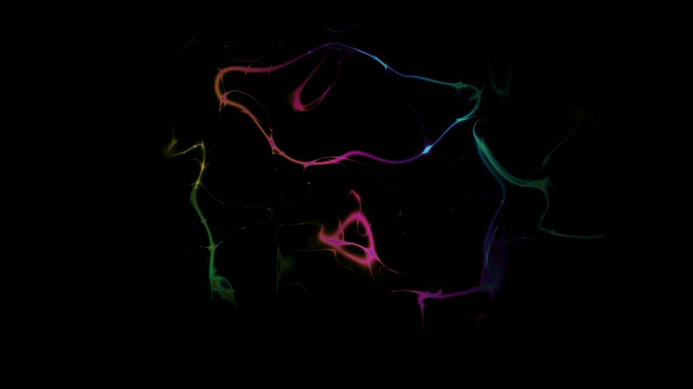

# Rainbow Veins

An interactive wall projection built in TouchDesigner. A hidden network of branching veins covers the wall. When someone moves in front of it, the veins near them light up in glowing rainbow colour. The light creeps outward along the branches, with pulses flowing through it. When everyone is still, it slowly fades back to black.



## How it works

```text
Orbbec infrared ─► soften + downscale ─► 1_ir_movement.glsl ──────┐
                                         (now vs. a slow average) │
                                                                  ├─► 2_movement_mix.glsl ─► blur ─┐
Orbbec depth ─► keep only what's closer than the empty room ──────┘                                │
               ─► compare with a few frames ago                                                   │
                                                                                                   ▼
                         Feedback TOP ◄─── 3_vein_spread.glsl  (640×360 "lit" map) ◄───────────────┘
                                                  │
         scripts/rv_sim.py ──── time + movement energy (uniform uV) ───┐
                                                  │                   │
                                                  ▼                   ▼
                                      4_vein_render.glsl  (1280×720)
                                          │                     │
                            Window COMP → projector     Movie File Out TOP → renders/rainbow_veins.mp4
```

1. **Movement from the camera.** An Orbbec depth camera supplies infrared and depth images. `1_ir_movement.glsl` compares each infrared frame with a slowly updated copy to find what moved. The depth image is masked against a capture of the empty room, then compared with a few frames earlier. `2_movement_mix.glsl` merges the two into one soft motion map.
2. **Light spreading along the veins.** `3_vein_spread.glsl` runs in a Feedback TOP loop at 640×360. Movement lights pixels up. Each frame, the light spreads to neighbouring pixels only where a vein runs, and everything fades a little.
3. **Per-frame Python.** `scripts/rv_sim.py` is an Execute DAT that runs at the start of every frame. It sends the shaders the time and a "movement energy" value, the average motion, which rises quickly and falls slowly.
4. **Drawing.** `4_vein_render.glsl` builds the veins procedurally from domain-warped ridged noise (3 octaves) that drifts over time. It colours them with a cosine rainbow palette based on position and time, then adds pulses, white-hot cores, tone mapping and a soft vignette.

## Parameters

| Parameter | File | Value | What it changes |
|---|---|---|---|
| Vein scale | both vein shaders | `5.0` | How many veins fit across the wall |
| Vein sharpness | both vein shaders | `pow(ridge, 10 + 6·octave)` | Thin, crisp veins vs. broad, soft ones |
| Vein drift | both vein shaders | `t × 0.03` | How fast the vein pattern slowly moves |
| Fade | `3_vein_spread.glsl` | `0.986` per frame | How long the light stays after people stop |
| Spread | `3_vein_spread.glsl` | `0.975` | How far the light travels along a vein |
| Sensitivity | `rv_sim.py` | `mean × 25 − 0.03` | How much movement counts as energy |
| Energy attack / release | `rv_sim.py` | `0.1` / `0.02` | How fast energy rises / falls |
| Pulse speed | `4_vein_render.glsl` | `2 + 4 × energy` | Pulses flow faster when people move more |
| Brightness boost | `4_vein_render.glsl` | `1 + 0.8 × energy` | The wall gets brighter with more movement |
| Motion softness | `rv_move_soft` (Blur TOP) | `70` | How wide an area one person lights up |

## Exporting to a video file

The `rv_record` node (a Movie File Out TOP) is wired straight to the `rainbow_veins` shader.

1. Plug in the camera and open `rainbow_veins.toe`.
2. In `rv_record`'s parameters, turn **Record** on and move in front of the camera.
3. Turn **Record** off. The clip is saved as `renders/rainbow_veins.mp4`: 1280×720, 60 fps, MPEG-4.

Recording happens in real time, so every clip is a one-off performance driven by whoever is in front of the wall. Each new recording replaces the last one, so rename any take you want to keep. H.264 encoding needs a Commercial TouchDesigner licence, which is why the recorder uses MPEG-4.

## Files

| File | What it is |
|---|---|
| `rainbow_veins.toe` | The TouchDesigner project. The Rainbow Veins nodes live in `/project1/people_trails` and are named `rv_*` and `liq_*`. |
| `shaders/` | The four GLSL pixel shaders, exported from the live project |
| `scripts/rv_sim.py` | The per-frame Execute DAT |
| `scripts/rainbow_veins_build.py` | The Python script that first built the network inside TouchDesigner. Its shaders are an earlier version; `shaders/` has the current ones. |

## Running it

- TouchDesigner 2025.33070 or newer
- An Orbbec depth camera. Without one, the veins stay dark, because nothing is lighting them.
- A depth capture of the empty room for `saved_background`. This isn't included; capture your own with no one in view.
